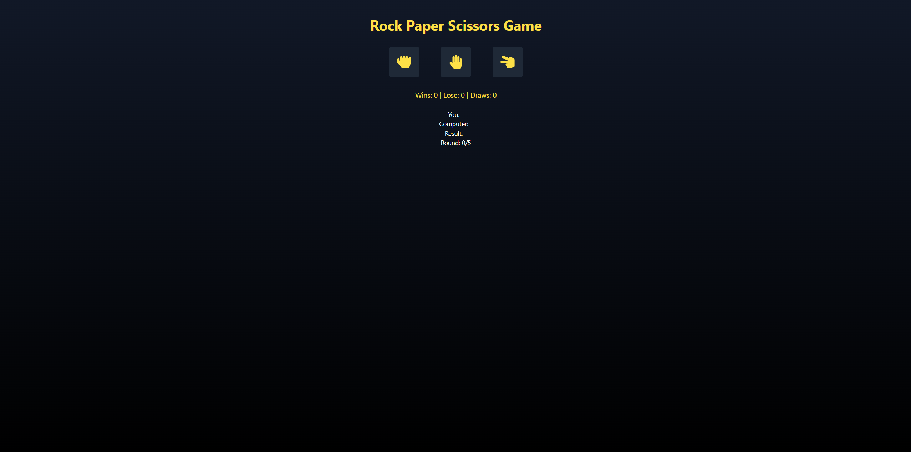
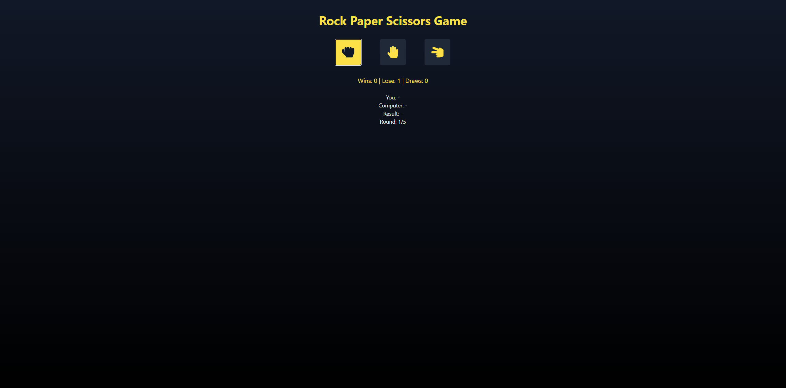
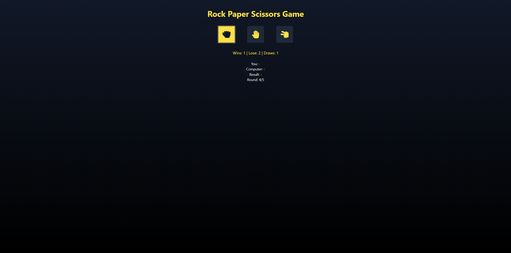
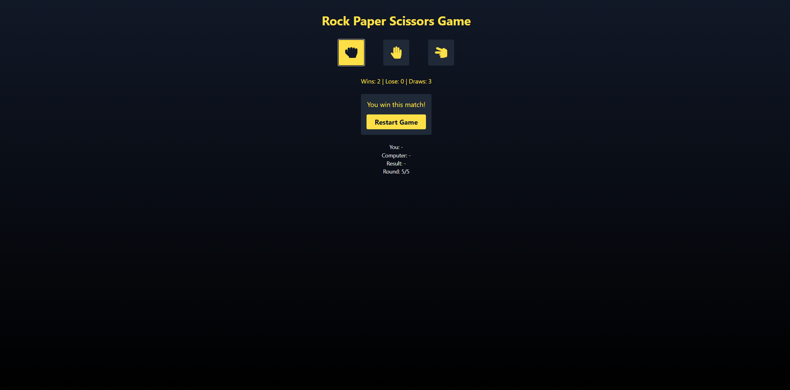

# 🎮 Rock Paper Scissors Game

A modern, interactive Rock Paper Scissors game built with React. Play a best-of-5 match against the computer with real-time score tracking and smooth animations.



## 🚀 Live Demo

**[Play the Game](https://martin-frei.github.io/React-RSPGame/)** 

## ✨ Features

- 🎯 **Best of 5 System** - Complete matches with round tracking
- 📊 **Live Score Tracking** - Real-time wins, losses, and draws counter
- 🎨 **Modern UI** - Gradient background with smooth hover effects
- 🎭 **Icon-Based Controls** - Intuitive hand gesture icons from React Icons
- ⏱️ **Smart Timing** - Automatic round reset with visual feedback
- 🔒 **Game State Management** - Buttons disabled after match completion
- 🔄 **Quick Restart** - Reset game instantly with one click
- 📱 **Responsive Design** - Works perfectly on all screen sizes

## 🎯 How to Play

1. Choose your move: Rock 🪨, Paper 📄, or Scissors ✂️
2. Computer makes its choice automatically
3. Winner is determined based on classic rules:
   - Rock beats Scissors
   - Paper beats Rock
   - Scissors beats Paper
4. First to win 3 rounds wins the match!
5. Click "Restart Game" to play again

## 📸 Screenshots

### Main Game Interface


### During Gameplay


### Round Result - Draw


### Match Victory


## 🛠️ Tech Stack

- **React 19** - Latest React version with Hooks
- **React Icons** - Professional icon library (Font Awesome)
- **Tailwind CSS** - Utility-first styling framework
- **JavaScript ES6+** - Modern JavaScript features

## 🎯 Key Concepts Demonstrated

- ✅ **React Hooks** - useState, useEffect with complex state management
- ✅ **Game Logic** - Winner calculation algorithm
- ✅ **State Management** - Multiple coordinated state variables
- ✅ **Conditional Rendering** - Dynamic UI based on game state
- ✅ **Event Handling** - User input and game flow control
- ✅ **Timing Control** - setTimeout for game pacing
- ✅ **Component Architecture** - Clean, reusable component structure
- ✅ **Responsive Design** - Mobile-first approach with Tailwind

## 🚀 Getting Started

### Prerequisites

- Node.js (v14 or higher)
- npm or yarn

### Installation

1. **Clone the repository**
   ```bash
   git clone https://github.com/Martin-Frei/React-RSPGame.git
   cd React-RSPGame
   ```

2. **Install dependencies**
   ```bash
   npm install
   ```

3. **Start the development server**
   ```bash
   npm start
   ```

4. **Open your browser**
   ```
   http://localhost:3000
   ```

## 📦 Project Structure

```
React-RSPGame/
├── public/
│   └── index.html
├── src/
│   ├── App.js              # Main app component
│   ├── RSPgame.jsx         # Game logic and UI
│   ├── App.css
│   └── index.js
├── screenshots/            # Game screenshots
├── package.json
└── README.md
```

## 🎮 Game Logic

### Round Determination
```javascript
if (playerChoice === computerChoice) {
  // Draw
} else if (
  (playerChoice === "rock" && computerChoice === "scissor") ||
  (playerChoice === "paper" && computerChoice === "rock") ||
  (playerChoice === "scissor" && computerChoice === "paper")
) {
  // Player wins
} else {
  // Computer wins
}
```

### Match Flow
1. User selects a choice (Rock/Paper/Scissors)
2. Computer generates random choice after 600ms delay
3. Winner is determined and score updated
4. Round result displayed for 3 seconds
5. Game resets for next round
6. After 5 rounds, final match winner is declared

## 🎨 Design Features

- **Gradient Background** - Eye-catching gray-900 to black gradient
- **Yellow Accent Color** - High-contrast yellow-300 for better visibility
- **Hover Effects** - Interactive button states with smooth transitions
- **Icon-Based UI** - Font Awesome hand gesture icons
- **Centered Layout** - Clean, focused game interface
- **Score Display** - Always visible win/lose/draw counters

## 🌱 Future Enhancements

- [ ] Add sound effects for moves and results
- [ ] Implement difficulty levels (Easy/Medium/Hard)
- [ ] Add multiplayer mode (local or online)
- [ ] Store game history in localStorage
- [ ] Add animations for hand gestures
- [ ] Implement tournament mode
- [ ] Add dark/light theme toggle
- [ ] Create leaderboard system

## 📚 What I Learned

This project helped me practice:
- Managing complex state with multiple useState hooks
- Coordinating timing with useEffect and setTimeout
- Implementing game logic and winner determination
- Creating responsive layouts with Tailwind CSS
- Using React Icons for better UI
- Building interactive user experiences
- Handling game flow and state transitions

## 🤝 Contributing

This is a portfolio project, but suggestions and feedback are welcome!

## 📄 License

This project is open source and available under the [MIT License](LICENSE).

## 👨‍💻 Author

**Martin Freimuth**
- GitHub: [@Martin-Frei](https://github.com/Martin-Frei)
- LinkedIn: [martin-freimuth](https://www.linkedin.com/in/martin-freimuth-089249359/)
- Email: mat.frei@gmx.de

## 🙏 Acknowledgments

- [React](https://reactjs.org/) - The amazing JavaScript library
- [React Icons](https://react-icons.github.io/react-icons/) - Beautiful icon library
- [Tailwind CSS](https://tailwindcss.com/) - Utility-first CSS framework
- Classic Rock Paper Scissors game for the inspiration

---

**⭐ If you enjoyed this game, please consider giving it a star!**

*Built with ❤️ using React and Tailwind CSS*

---

## 🎯 Game Rules Reminder

- 🪨 **Rock** beats Scissors
- 📄 **Paper** beats Rock  
- ✂️ **Scissors** beats Paper

**Good luck and have fun!** 🎮